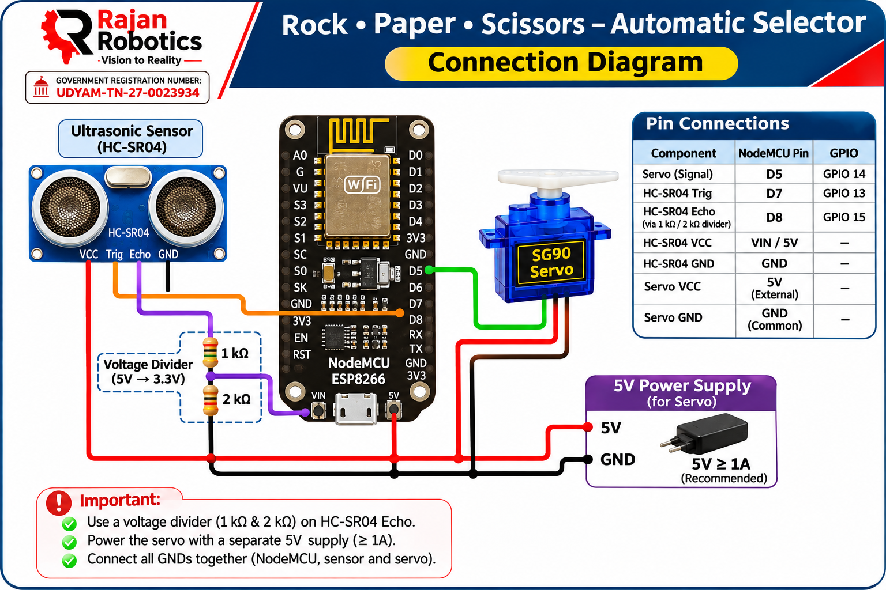

# Rock Paper Scissors with ESP8266 🎮

**An Automatic Rock, Paper, Scissors Selector using NodeMCU ESP8266, HC-SR04 Ultrasonic Sensor and SG90 Servo Motor.**

Developed by **Rajan Robotics – Vision to Reality**

---

## 📌 Project Overview

This project demonstrates an automatic Rock, Paper, Scissors selection system using an ESP8266 NodeMCU.

The system uses an HC-SR04 ultrasonic sensor to detect a player's hand. When the hand comes within 10 cm of the sensor, the ESP8266 triggers a random selection process.

An SG90 servo motor moves to one of three predefined positions to represent:

- ✊ Rock – 0°
- ✋ Paper – 90°
- ✌️ Scissors – 180°

The servo performs a quick shaking movement before displaying the randomly selected result.

## 🎯 Project Objectives

- Understand ultrasonic distance measurement.
- Interface an HC-SR04 sensor with ESP8266.
- Control a servo motor using PWM signals.
- Generate random selections using ESP8266.
- Implement sensor-based automation.
- Understand practical applications of embedded systems.

## 🛠️ Components Required

| S.No | Component | Quantity |
|---|---|---:|
| 1 | NodeMCU ESP8266 | 1 |
| 2 | HC-SR04 Ultrasonic Sensor | 1 |
| 3 | SG90 Servo Motor | 1 |
| 4 | 1 kΩ Resistor | 1 |
| 5 | 2 kΩ Resistor | 1 |
| 6 | External 5V Power Supply (1A or higher) | 1 |
| 7 | Jumper Wires | As required |
| 8 | USB Cable | 1 |

## 🔌 Circuit Connections

### 1. HC-SR04 Ultrasonic Sensor

| HC-SR04 Pin | NodeMCU Pin |
|---|---|
| VCC | VIN / 5V |
| Trig | D7 (GPIO 13) |
| Echo | D8 (GPIO 15) through voltage divider |
| GND | GND |

**Important:** The HC-SR04 Echo pin produces a 5V signal. ESP8266 GPIO pins are 3.3V tolerant. Use a voltage divider to reduce the Echo voltage.

Voltage divider connection:

- HC-SR04 Echo → 1 kΩ resistor → D8 junction
- D8 junction → 2 kΩ resistor → GND

This reduces the 5V Echo signal to approximately 3.3V.

### 2. SG90 Servo Motor

| Servo Wire | Connection |
|---|---|
| Brown | External 5V GND |
| Red | External 5V |
| Orange | D5 (GPIO 14) |

**Important Power Considerations:**

- Use a separate regulated 5V supply for the servo (1A or higher recommended).
- Connect external power supply GND to NodeMCU GND.
- All circuit grounds must be connected together.
- Do not power the servo directly from the ESP8266 3.3V output.

## 📊 Pin Mapping

| Component | NodeMCU Pin | ESP8266 GPIO |
|---|---|---|
| Servo Signal | D5 | GPIO 14 |
| Ultrasonic Trig | D7 | GPIO 13 |
| Ultrasonic Echo | D8 | GPIO 15 |

## ⚙️ Working Principle

1. The HC-SR04 ultrasonic sensor continuously measures the distance.
2. The ESP8266 calculates the distance using the Echo pulse duration.
3. When a hand is detected within 10 cm, the system triggers the selection process.
4. The servo motor performs three quick shaking movements.
5. The ESP8266 randomly generates one of three choices.
6. The servo moves to the corresponding angle.
7. The selected result is displayed on the Serial Monitor.

## 🎮 Servo Position Mapping

| Selection | Servo Angle |
|---|---:|
| Rock | 0° |
| Paper | 90° |
| Scissors | 180° |

## 💻 Software Requirements

- Arduino IDE
- ESP8266 Board Package
- ESP8266 Servo library / Servo support for ESP8266
- USB Driver for NodeMCU

### Board Configuration

- Board: NodeMCU 1.0 (ESP-12E Module)
- Upload Method: USB
- Baud Rate: 115200

## 🚀 Upload Instructions

1. Install Arduino IDE.
2. Install the ESP8266 board package.
3. Connect NodeMCU to the computer using a USB cable.
4. Open the project Arduino sketch.
5. Select **NodeMCU 1.0 (ESP-12E Module)**.
6. Select the appropriate COM port.
7. Upload the program.
8. Open Serial Monitor at 115200 baud.
9. Place your hand within 10 cm of the ultrasonic sensor.
10. Watch the servo select Rock, Paper or Scissors!

## 🔍 Serial Monitor Output

Example:

```text
System Ready! Place hand closer than 10cm to play.

--- Hand Detected! Shuffling... ---

Result: ROCK (0 Degrees)
```

Possible results:

```text
Result: ROCK (0 Degrees)
Result: PAPER (90 Degrees)
Result: SCISSORS (180 Degrees)
```

## 🔧 Project Parameters

| Parameter | Value |
|---|---|
| Microcontroller | ESP8266 |
| Detection Sensor | HC-SR04 |
| Servo Motor | SG90 |
| Detection Distance | 10 cm |
| Servo Positions | 0°, 90°, 180° |
| Cooldown Period | 2 seconds |
| Servo Shuffle Cycles | 3 |
| Serial Communication | 115200 baud |

## 🌟 Applications

- Interactive STEM learning projects.
- Robotics demonstrations.
- Embedded systems training.
- Sensor-based automation.
- Random decision-making systems.
- School and college project exhibitions.

## 📚 Learning Outcomes

By building this project, students can learn:

- ESP8266 GPIO interfacing.
- Ultrasonic sensor operation.
- Distance calculation using pulse duration.
- Servo motor control.
- PWM fundamentals.
- Random number generation.
- Embedded C/C++ programming.
- Hardware and software integration.

## 🏫 About Rajan Robotics

**Rajan Robotics – Vision to Reality**

Rajan Robotics is a government-registered organization focused on teaching, training and motivating students to develop future-ready technical skills.

We provide practical learning experiences in:

- Robotics
- Arduino and ESP32
- Embedded Systems
- Internet of Things (IoT)
- Fundamental Electronics
- STM32
- FPGA and VLSI
- Python Programming
- STEM Education

**Government Registration Number:** UDYAM-TN-27-0023934

## 📞 Contact

**Rajan Robotics**

📱 Phone: 860 87 940 34

**Vision to Reality**

---

⭐ If you find this project useful, consider giving this repository a star!

#RajanRobotics #ESP8266 #NodeMCU #ArduinoIDE #Robotics #EmbeddedSystems #UltrasonicSensor #ServoMotor #STEMEducation #RockPaperScissors

## 🔌 Connection Diagram


